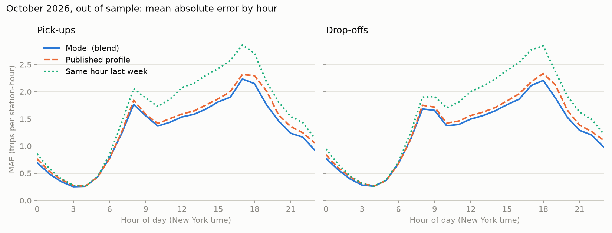
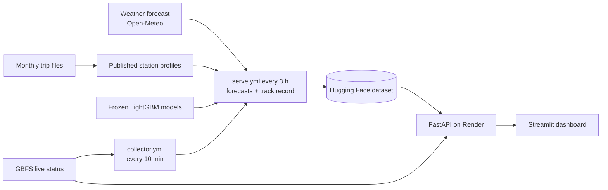

# Citi Bike demand forecasting and stockout alerts

Hourly forecasts of pick-ups and drop-offs at every Citi Bike station in New York, one to six hours ahead,
turned into warnings for stations about to run out of bikes or docks, with suggested bike moves. It runs
live on free hosting and keeps score of its own alerts against real stockouts.

**Live:** [dashboard](https://citibik.streamlit.app/) · [API docs](https://citibike-api-vk26.onrender.com/docs) ·
[published forecasts](https://huggingface.co/datasets/himel05/citibike-artifacts)
(the API sleeps when idle; the first request can take about a minute)

**Full write-up:** [reports/FINAL_REPORT.md](reports/FINAL_REPORT.md)

## Results

Forecast error, blended model vs two baselines (lower MAE is better; the target was ≥ 15% over last week):

| | vs "same hour last week" | vs published station profile | Hours above P90 (target 10%) |
|---|---|---|---|
| September 2026, test month, scored once | 24.0% pick-ups / 23.4% drop-offs | 13.2% / 12.9% | 11.5% / 11.6% |
| October 2026, never seen, forecast weather | 20.5% / 20.3% | 5.3% / 5.1% | 11.8% / 12.1% |

Stockout alerts on 201 hourly checks the alert levels weren't tuned on (Oct 26 – Nov 6):

| | Alerts that came true | Stockouts warned in advance |
|---|---|---|
| Empty: forecast alert | 70% | 73% |
| Empty: "nearly empty now" | 73% | 63% |
| Full: forecast alert | 78% | 76% |
| Full: "nearly full now" | 79% | 68% |

The forecast also warns about roughly one in five stockouts at stations that look fine when the alert fires,
which the current-stock rule can't catch. Sources: [`test_results.csv`](reports/test_results.csv),
[`october_results.csv`](reports/october_results.csv), [`backtest_alerts.csv`](reports/backtest_alerts.csv).



## How it works



- **Forecast.** One LightGBM model per target (Tweedie loss) on calendar, weather, station location,
  capacity and ID, blended hour by hour with each station's profile from published trip months. Quantile
  models give a 90th-percentile bound. Citi Bike publishes trips monthly, so the model uses no recent trips
  at all; that's also why serving is cheap.
- **Alerts.** Projected stock = bikes now + forecast drop-offs − forecast pick-ups, hour by hour. A station
  is flagged if it is projected to run empty or full within three hours. Moves pair it with the nearest
  station within 2 km that stays 30–70% full.
- **Serving.** A scheduled GitHub Actions job builds forecasts and the track record and publishes them to a
  Hugging Face dataset. The API reads those files and the live station feed, and the dashboard reads the API.

Time-based splits only, one run on the test month, and a mutation test that checks no feature can see the
future. Details, limitations and next steps are in the [final report](reports/FINAL_REPORT.md).

## Reproduce

Python 3.12 with [uv](https://docs.astral.sh/uv/). Data stays out of git; these commands rebuild it.

```bash
uv venv --python 3.12 && uv pip install -r requirements.txt
python -m src.ingest.download_trips --months 13              # trip CSVs, Oct 2025 - Oct 2026
python -m src.ingest.weather --start 2025-10-01 --end 2026-11-01
python -m src.ingest.station_hour                            # cleaned trips + station x hour grid (~1.5 min)
python -m src.features.build                                 # feature table (~70 s, 4.8 GB peak)
python -m src.models.final prepare                           # frozen config from the validation months
python -m src.models.final test                              # the single September run (refuses a rerun)
python -m src.models.evaluate --live data/processed/forecasts_oct15_28.parquet   # October scoring
python -m src.models.predict 2026-10-15 2026-11-07           # cached forecasts for the backtest
python -m src.decision.backtest                              # alert precision and recall
python -m src.api.publish                                    # forecasts + track record -> data/serving
ARTIFACTS=local python -m uvicorn src.api.main:app           # API on :8000
python -m streamlit run app/streamlit_app.py                 # dashboard on :8501
python reports/make_october_figure.py                        # the figure above
python -m pytest -q tests
```

Training extras (SHAP, Prophet, matplotlib) aren't in `requirements.txt`, which covers the API and tests.

## Layout

```
src/ingest/      trip download, GBFS collector, weather, station_hour build
src/features/    build.py: the one feature module for training and serving
src/models/      training, evaluation, tuning, SHAP, Prophet, final run, serving forecasts
src/decision/    stock projection, alerts, moves, alert backtest
src/api/         FastAPI app and the publish job
app/             Streamlit dashboard
notebooks/       exploratory analysis
reports/         final report, October report, figures, experiment log, results tables
.github/         collector (every 10 min), serve (every 3 h), CI
```

## Data sources

| Data | Source | Terms |
|---|---|---|
| Trips, Oct 2025 – Oct 2026 | [Citi Bike System Data](https://citibikenyc.com/system-data), monthly files from [s3.amazonaws.com/tripdata](https://s3.amazonaws.com/tripdata/index.html) | [Citi Bike Data License Agreement](https://citibikenyc.com/data-sharing-policy) |
| Live station status and info, every 10 min since Oct 15, 2026 | Citi Bike's public [GBFS feed](https://gbfs.lyft.com/gbfs/1.1/bkn/en/station_status.json) | Citi Bike Data License Agreement |
| Hourly weather: observed (training), archived forecasts (backtests), live forecast (serving) | [Open-Meteo](https://open-meteo.com/), one point in Midtown | [CC BY 4.0](https://open-meteo.com/en/license) |
| US / New York public holidays | [`holidays`](https://github.com/vacanza/holidays) | MIT |

## References

- Ke, G. et al. (2017). [LightGBM: A Highly Efficient Gradient Boosting Decision Tree](https://proceedings.neurips.cc/paper/2017/hash/6449f44a102fde848669bdd9eb6b76fa-Abstract.html). NeurIPS 30.
- Lundberg, S. M. and Lee, S.-I. (2017). [A Unified Approach to Interpreting Model Predictions](https://proceedings.neurips.cc/paper/2017/hash/8a20a8621978632d76c43dfd28b67767-Abstract.html). NeurIPS 30.
- Taylor, S. J. and Letham, B. (2018). [Forecasting at Scale](https://doi.org/10.1080/00031305.2017.1380080). *The American Statistician* 72(1).

*Trip and station data: Citi Bike System Data, used under the Citi Bike Data License Agreement; this project is
not affiliated with or endorsed by Citi Bike or Lyft. Weather data by Open-Meteo.com (CC BY 4.0).*
