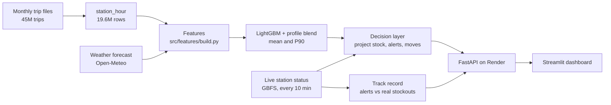
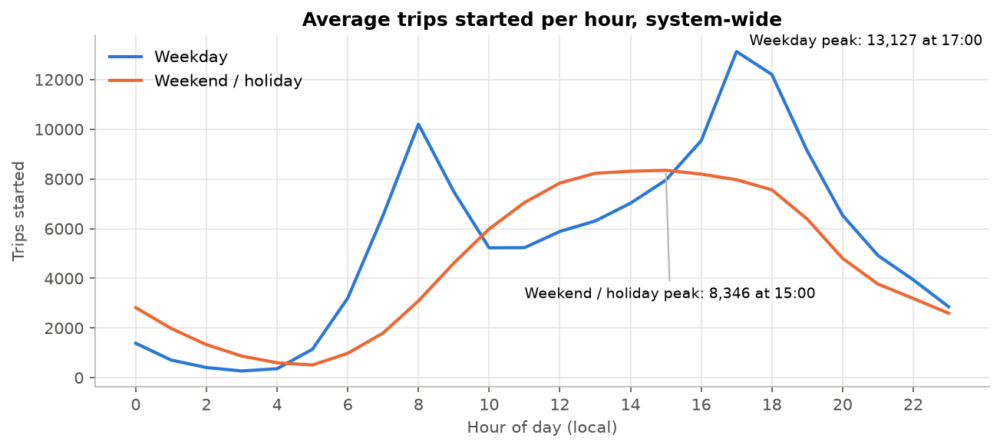
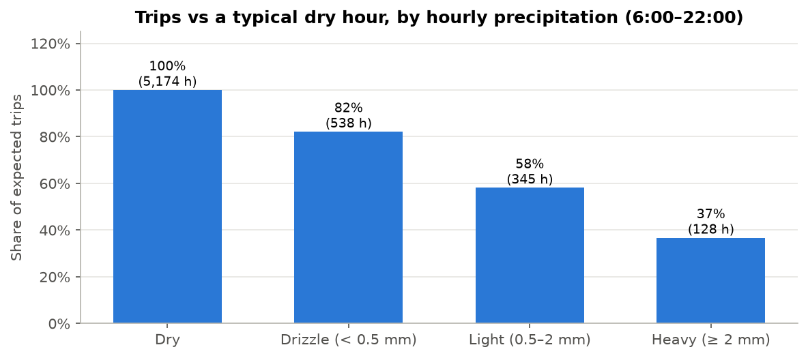
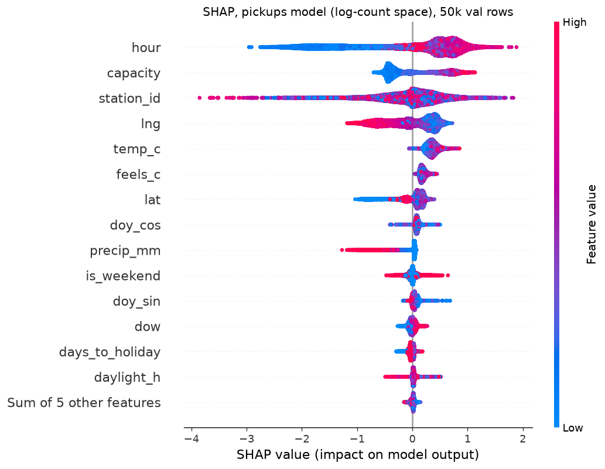

# Citi Bike demand forecasting and stockout alerts

Forecasts hourly pick-ups and drop-offs at every Citi Bike station in New York 1–6 hours ahead, flags stations
about to run empty or full, and suggests bike moves to prevent it.

**Live:** [dashboard](https://citibik.streamlit.app/) · [API docs](https://citibike-api-vk26.onrender.com/docs)
(the first request after a quiet spell takes about a minute while the API wakes up)

| Result | Value |
|---|---|
| Forecast accuracy, held-out month (Sep 2026) | **24% lower error** than "same hour last week" on pick-ups (target ≥ 15%); 23% on drop-offs |
| Against the best baseline production could use (station's published average) | 13% lower error |
| Empty-station alerts, Oct 19–26 (overlaps the tuning days, so optimistic) | 71% of stockouts warned in advance vs 60% for "nearly empty now"; 70% of alerts came true |
| Full-station alerts, same period | 75% warned vs 66%; 77% of alerts came true |
| Stockouts caught before the station was low at all | ~20% (the "nearly empty now" rule can't catch any) |

## How it works



1. **Data.** A year of trips (Oct 2025 – Sep 2026, 45.2M after cleaning) is aggregated into a full
   station × hour grid with zeros, weather and holidays. A GitHub Actions job has saved live station status
   every 10 minutes since Oct 15, 2026; that is the ground truth for stockouts.
2. **Forecast.** One LightGBM model per target on calendar, weather, station location/capacity and station ID,
   with a Tweedie loss, blended hour by hour with each station's average profile from published trip months.
   Quantile models give a cautious 90th-percentile bound.
3. **Decision layer.** Projected stock = bikes now + forecast drop-offs − forecast pick-ups, clipped to the
   station's free slots hour by hour. A station is flagged if it is projected to hit the alert level within
   3 hours; the cautious variant uses the 90th-percentile demand. Moves pair each at-risk station with the
   nearest station within 2 km that stays 30–70% full.
4. **Serving.** Every 3 hours a GitHub Actions job builds the next 48 hours of forecasts and the 7-day track
   record and publishes them to a Hugging Face dataset. The API downloads those files and reads live station
   status on each request (cached for a minute), so it runs on a free host.

## What the data showed



- **Commute vs leisure.** Weekdays peak at 8:00 and 17:00; weekends have one plateau from noon to 16:00.
  Weekday holidays sit halfway between, so holidays get their own flag.
- **Season and weather.** June had 4.4× the trips of February. Daily trips track temperature (r = 0.84).
  Light rain cuts an hour's trips to 58% of a dry hour, heavy rain to 37%.
- **Mirror flows.** Stations that drain in the morning fill in the evening (correlation −0.94), which is
  what rebalancing fights.
- **Stockouts.** At any moment about 10% of stations are full and 4% empty, so full matters as much as empty.



## Modeling decisions

**What does production actually know?** Citi Bike publishes trips once a month, 3–12 days after the month ends.
A live forecast can't use last hour's or last week's trips. Features were split by availability:

| Tier | Contents | Used |
|---|---|---|
| A | Calendar, holiday, daylight, weather, station location and capacity | In the model |
| C | Station profiles from trip months already published when the forecast is made | Only as the blend |
| B | Fresh trip lags (6 h to 2 weeks) | Upper bound only, never reported as production accuracy |

Findings that shaped the final model (full log in [`reports/experiments.csv`](reports/experiments.csv)):

- **Trip-history features made forecasts worse.** Every model reading past trip levels over-predicted summer
  by 8–26%: the training months were all spring growth, where demand outran its recent level by 1.3–1.8×, and
  the trees carried that growth into a flat summer. The published profile helps only as a linear blend.
  A side effect: serving needs no live trip data.
- **Rain is where the model earns its keep:** in heavy rain it is 38–40% better than the profile. Its weak
  spot is the 7–9 a.m. peak, where the blend leans on the profile.
- **Alternatives that lost:** CatBoost (6–9% worse, much slower even on GPU), squared-error and absolute
  losses, and Prophet (22% worse on the 20 busiest stations).
- **The 90th-percentile bound is calibrated:** 11.5% of September hours were above it (target 10%). Summed
  over several hours it was too wide, so the decision layer shrinks it (fit on August, out of sample).
- **The test month was used once**, after the configuration was frozen, and is guarded in code.

Test-month detail ([`reports/test_results.csv`](reports/test_results.csv)): pick-ups MAE 1.37 vs 1.80 for
"same hour last week" and 1.58 for the published profile. Without the Sep 26–28 storm (51 mm of rain on Sep 27)
the gain is 22.1% on pick-ups and 21.7% on drop-offs.



## Alerts and the track record

Alert levels were tuned by F1 on Oct 15–25 snapshots ([`reports/backtest_alerts.csv`](reports/backtest_alerts.csv))
and frozen. The dashboard's **Track record** tab rescores the last 7 days every 3 hours, counting only alerts
made after Oct 26 so the levels are scored out of sample: an alert counts as correct if the station really hit
0 bikes (or 0 free docks) in a saved snapshot within 3 hours. The comparison is "alert if nearly empty/full
now", which is what you'd do without a forecast.

The table below is the first run, Oct 19–26. Most of those days were also used to pick the alert levels, so
treat it as optimistic; the dashboard shows the out-of-sample numbers as they accumulate (a full week from
about Nov 2).

| Oct 19–26, 127 hourly checks (mostly in-sample) | Alerts that came true | Stockouts warned | Caught early |
|---|---|---|---|
| Empty: forecast | 70% | 71% | 22% |
| Empty: "nearly empty now" | 73% | 60% | 0% |
| Full: forecast | 77% | 75% | 19% |
| Full: "nearly full now" | 78% | 66% | 0% |

The forecast trades about 1–3 points of precision for 9–11 points of recall, and it is the only one that warns
about stations that are still healthy.

## Limitations

- **Serving weather comes from the forecast; training used observed weather.** Live error will be higher than
  the offline numbers. October is the first month where this can be measured (below).
- **Precision is a lower bound.** Citi Bike's own trucks and Bike Angels move bikes after an alert, so some
  "false alarms" were stockouts that someone prevented.
- **Seasonal turns lag.** September ran ~9% above forecast as people returned to work; monthly retraining is
  the fix.
- **Not in the model:** planned events (Summer Streets caused the largest single errors, up to 4× normal
  demand), station closures, and new stations until the next retrain (they get zero flow; ~5% of stations).
- **One weather point** (Midtown) for the whole city.
- **Moves** are one per at-risk station, straight-line distance, no truck routing.
- **The past week's forecasts in the track record are rebuilt** with archived weather forecasts rather than
  stored when issued. The model is frozen, so the result is the same apart from small weather-forecast
  revisions.

## October accuracy

*Pending.* October's trip file is published in early November. Scoring it will give the first accuracy number
for forecasts made with forecast weather, the way the live system runs.

## Reproduce

Python 3.12 with [uv](https://docs.astral.sh/uv/). Data stays out of git; the commands rebuild it.

```bash
uv venv --python 3.12 && uv pip install -r requirements.txt
python -m src.ingest.download_trips --months 12          # 8.3 GB of trip CSVs
python -m src.ingest.weather --start 2025-10-01 --end 2026-10-01
python -m src.ingest.station_hour                        # cleaned trips + station_hour (~1.5 min)
python -m src.features.build                             # feature table (~70 s, 4.8 GB peak)
python -m src.models.final prepare                       # tree counts from the val months (frozen config)
python -m src.models.final test                          # retrain Oct-Aug, the single test run (refuses a rerun)
python -m src.api.publish                                # forecasts + track record -> data/serving
ARTIFACTS=local python -m uvicorn src.api.main:app       # API on :8000
python -m streamlit run app/streamlit_app.py             # dashboard on :8501
python -m pytest -q tests
```

Training extras (SHAP, Prophet, matplotlib) aren't in `requirements.txt`, which covers the API and tests.

## Layout

```
src/ingest/      trip download, GBFS collector, weather, station_hour build
src/features/    build.py: the one feature module for training and serving
src/models/      training, evaluation, tuning, SHAP, Prophet, final run, serving forecasts
src/decision/    stock projection, alerts, moves, alert backtest
src/api/         FastAPI app and the publish job
app/             Streamlit dashboard
notebooks/       01_eda.ipynb
reports/         figures, experiment log, test results, alert backtest
.github/         collector (every 10 min), serve (every 3 h), CI
```

*Trip data: Citi Bike System Data, used under the Citi Bike data license; this project is not affiliated with
or endorsed by Citi Bike or Lyft. Weather data by Open-Meteo.com (CC BY 4.0).*
