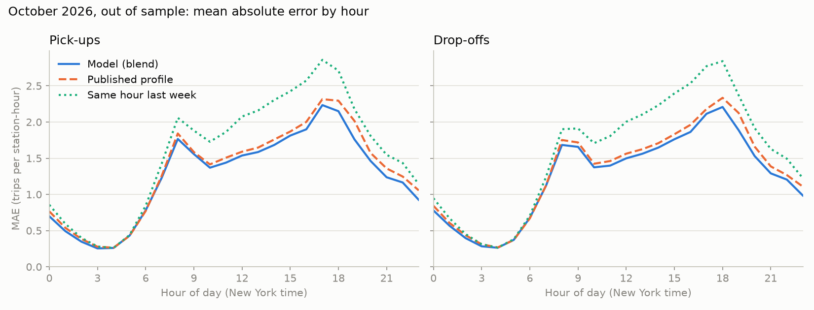
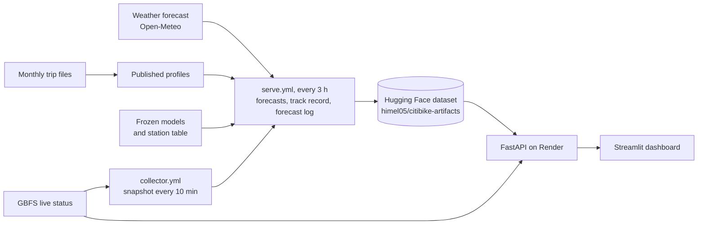

# Citi Bike station demand: forecasts, stockout alerts and a live service

Final report, November 2026. Repository: [Ignite-0/Bike-Share-Demand-Forecasting-](https://github.com/Ignite-0/Bike-Share-Demand-Forecasting-).
Live: [dashboard](https://citibik.streamlit.app/) · [API](https://citibike-api-vk26.onrender.com/docs) ·
[published files](https://huggingface.co/datasets/himel05/citibike-artifacts).

## Summary

The project forecasts hourly pick-ups and drop-offs at every public Citi Bike station in New York, one to six
hours ahead, and uses those forecasts to warn about stations that are about to run out of bikes or docks. It
runs as a small live service: a scheduled job publishes forecasts every three hours, an API serves them with
live station status, and a dashboard shows alerts, suggested bike moves and a running track record.

The goal set at the start was to beat "same hour last week" by at least 15% MAE on a held-out month. The
model did that on September 2026 (24.0% on pick-ups, 23.4% on drop-offs, scored once) and again on October,
which it never saw in any form (20.5% and 20.3%). Against a tougher baseline, each station's published
average profile, the margin is smaller: 13.2% / 12.9% in September and 5.3% / 5.1% in October.

The alerts were scored against real stockouts in live snapshots. On 201 hourly checks the model wasn't tuned
on, the empty-station alert caught 73% of stockouts at 70% precision, against 63% at 73% for the obvious rule
"alert if the station is nearly empty now". Full stations: 76% at 78% precision, against 68% at 79%. The
forecast also catches about one in five stockouts at stations that look fine at the moment of the alert,
which the current-stock rule can't do at all.

## 1. Problem and data

Citi Bike stations drain and fill with the commute. A station near Penn Station gains about 105 bikes on a
weekday morning, while residential stations in Hell's Kitchen or the East Village lose 40–60, and the pattern
reverses in the evening (station-level correlation between morning and evening net flow: −0.94). An operator
who knows a few hours ahead which stations will hit zero bikes or zero docks can move bikes before it happens.

Data used:

| Source | What | Volume |
|---|---|---|
| Citi Bike monthly trip files | Oct 2025 – Oct 2026 | 45.2M trips through September after cleaning (0.4% removed) |
| Citi Bike GBFS feed | bikes and docks available per station, saved every 10 minutes since Oct 15, 2026 | ground truth for stockouts |
| Open-Meteo | hourly weather at one Midtown point: observations for training, archived forecasts for backtests, live forecast for serving | |
| `holidays` package | US / New York public holidays | |

The trips are aggregated into a full station × hour grid with zeros for empty hours: 19.6M station-hours
over 2,432 public stations for Oct 2025 – Sep 2026. Each station's grid runs from its first to its last
trip, so a station isn't credited with zeros before it opened. Cleaning drops trips under 60 s or over 24 h,
trips without a start or end station, depots, demo docks and the Jersey City / Hoboken stations (the NYC
files only hold their cross-river trips). Some monthly files had lost a trailing zero in station IDs
(`5997.1` vs `5997.10`), which split about 100 stations in two until the IDs were normalized.

A few things in the data shaped the rest of the project:

- Weekdays peak at 8:00 and 17:00; weekends have one plateau from noon to 16:00. Weekday holidays sit in
  between, so holidays get their own flag instead of being treated as weekends.
- June had 4.4× the trips of February, daily trips track temperature (r = 0.84), and rain hits hard: an hour
  with light rain (0.5–2 mm) has 58% of a dry hour's trips, heavy rain 37%.
- The busiest 10% of stations carry 40% of trips; 16% of stations see fewer than 5 trips a day. Overall MAE
  is dominated by quiet stations, so errors are also reported as WAPE and by station cluster and volume.
- In the first live snapshots about 10% of stations were full and 4% empty at any moment. Full docks are the
  more common problem, so the alerts cover both.
- The system was shut for 33 hours in a February snowstorm (no trips from Feb 22, 20:00 to Feb 24, 05:00).
  Those hours are masked from training targets and from lag features. The test month had a storm too
  (51 mm of rain on Sep 27), so September results are reported with and without Sep 26–28.

Stations were grouped with k-means (k = 4) on the shape of their weekday profile, fit on training months
only: residential, evening-heavy, balanced and business, plus a low-volume group. The clusters are used for
reporting, not as model inputs.

## 2. Method

### What a live forecast can know

The main constraint is that Citi Bike publishes trips once a month, 3 to 12 days after the month ends. A
forecast made today can't use last hour's or last week's trips. Features are therefore split by when they
are available (`src/features/build.py`, one module for both training and serving):

| Tier | Contents | Role |
|---|---|---|
| A | calendar, holiday flags, daylight, day of year, weather, station capacity and location | model input |
| C | per-station profiles (long-run, and the last 28 days for the same hour and day type) built only from months already published when the forecast is made | blend partner and baseline |
| B | fresh trip lags (6 h to 2 weeks) | upper bound only, never reported as production accuracy |

For tier C a month counts as available from the 15th of the next month; the slowest release seen was the
12th, and a test keeps that margin. An earlier rule with a fixed six-week lag turned out to leak the first
days of a month (July 2026 trips appeared 42.7 days after July 1) and was replaced.

### Model

One LightGBM model per target on tier A plus `station_id` as a categorical feature, with a Tweedie loss
(variance power 1.2) and tuned settings (255 leaves, learning rate 0.0805, at least 200 rows per leaf). Its
output is blended with the tier-C published profile using one weight per hour of day. For the final models
the weights were fit on August with a model trained on Oct–Jul, so they come from a month that model hadn't
seen. The profile gets more weight before dawn and in the morning peak, the model more in
the afternoon and evening. Two LightGBM quantile models (α = 0.9) give a cautious upper bound for each target.

How it got there (every run is in [`experiments.csv`](experiments.csv)):

- Feeding past trip levels into the model made it worse. Every variant with tier B or C features
  over-predicted the summer validation months by 8–26%. The training months end in the spring ramp-up, when
  demand runs 1.3–1.8× above its level a month earlier, and the trees learned that multiplier. In July and
  August the ratio was 1.0. The published profile helps only when it enters linearly, through the blend.
  A useful side effect is that serving needs no live trip data at all.
- Count losses beat squared error by about 5–6% MAE. Tweedie 1.2 was picked over Poisson because it was
  within 1% and twice as fast.
- CatBoost was 6–9% worse and 3.5–19× slower, GPU included. Prophet, fit per station on the 20 busiest
  stations, was 22% worse than the blend.
- Tuning (20 random trials) gained 3%. The number of leaves mattered far more than anything else.

On validation the model was much better than the profile in heavy rain (38–40% lower MAE at ≥ 2 mm per hour)
and worse in the 7–9 h morning peak. The hour-weighted blend was adopted to cover that weakness.

### P90 bound

On validation 10.2% of pick-up hours and 10.4% of drop-off hours landed above the P90, against a 10% target,
and the bound held at busy stations (9.1% above at stations with 80+ trips a day). A Poisson interval around
the mean was too narrow exactly where stockouts happen (13% above at busy stations). Hourly quantiles don't add
up, though: the sum of six hourly P90s overstates the P90 of the six-hour total. A correction fit on August
shrinks the summed spread to 0.96 of its raw value at 1 h and 0.50 at 6 h.

## 3. Evaluation protocol

- Time-based splits only: Oct 2025 – Jun 2026 train (14.41M rows), Jul – Aug 2026 validation (3.43M),
  September 2026 test (1.68M). During development models were fit on Oct–May, early-stopped on June and
  scored on Jul–Aug.
- The test month was used once. The configuration was frozen in `models/final_config.json` before the run,
  the four models were retrained on Oct–Aug with fixed tree counts, and September was scored on Oct 23.
  The data loader refuses the test split unless asked for it explicitly with `final=True`, and
  `final.py test` refuses a second run.
- October is a separate `live` split, never trained or tuned on. Its forecasts were cached Oct 15–28 before
  October's trip file existed, with archived weather forecasts, so they are scored as they were issued.
- Leakage checks: a mutation test changes every target after a date and confirms no feature moves, tier by
  tier; tier C values are recomputed independently in pandas; a deliberately injected leak was caught by both.
- Two baselines: "same hour last week" (the project's target), and the published profile (`recent_profile`,
  falling back to the long-run profile), which uses the same data a production system would have.
- Metrics: MAE, RMSE, WAPE (sum of absolute errors over sum of actuals) and bias, broken down by cluster,
  volume tier, day type and hour.

## 4. Results

### September 2026 (test, single run)

From [`test_results.csv`](test_results.csv), the blended forecast:

| | MAE | WAPE | Bias | vs last week | vs profile | Above P90 |
|---|---|---|---|---|---|---|
| Pick-ups | 1.371 | 0.465 | −6.8% | **24.0%** | 13.2% | 11.5% |
| Pick-ups, without Sep 26–28 | 1.398 | 0.445 | −9.6% | 22.1% | 8.5% | 12.0% |
| Drop-offs | 1.382 | 0.469 | −6.1% | **23.4%** | 12.9% | 11.6% |
| Drop-offs, without Sep 26–28 | 1.406 | 0.447 | −9.1% | 21.7% | 8.3% | 12.2% |

Both targets clear the 15% bar by at least 6 points, with and without the storm. Two other findings:

- Everything, baselines included, ran about 9% low outside the storm. September is the return to work and
  school, and nothing in Oct–Aug training could see that coming.
- The blend didn't help on the test month: the model alone scored 1.353 on pick-ups. The blend leans on the
  profile, which misses the storm. It stays the reported configuration because it was chosen on validation,
  and switching after seeing the test result would be selecting on the test set.

Every cluster gained 11–14% over the profile on pick-ups (residential 13.4%, evening-heavy 12.6%, balanced
14.2%, business 11.5%).

### October 2026 (out of sample)

From [`october_results.csv`](october_results.csv) and [`OCTOBER_REPORT.md`](OCTOBER_REPORT.md): 788,924
station-hours at 2,358 stations, Oct 15–28, forecast with forecast weather the way the live system runs.

| | MAE | RMSE | WAPE | Bias | vs last week | vs profile | Above P90 |
|---|---|---|---|---|---|---|---|
| Pick-ups | 1.253 | 2.439 | 0.443 | −2.0% | **20.5%** | 5.3% | 11.8% |
| Drop-offs | 1.254 | 2.435 | 0.443 | −1.7% | **20.3%** | 5.1% | 12.1% |

The target holds on a month the model never saw. The September under-forecast is gone (bias −2%). The edge
over the profile shrank: by mid-October the profile was built from September trips and had already caught up
with the post-summer level, while in September it was still averaging August.

By cluster (pick-ups):

| Cluster | MAE | WAPE | vs last week | vs profile | Above P90 |
|---|---|---|---|---|---|
| Residential | 1.262 | 0.445 | 22.2% | 6.0% | 11.3% |
| Evening-heavy | 0.946 | 0.526 | 21.5% | 7.3% | 12.4% |
| Balanced | 1.596 | 0.399 | 22.1% | 5.6% | 12.0% |
| Business | 1.675 | 0.418 | 14.9% | 2.6% | 10.9% |
| Low volume | 0.204 | 1.667 | −4.7% | 3.5% | 11.9% |
| New (opened after June) | 0.695 | 0.662 | −8.7% | −13.3% | 10.9% |

New stations lose to both baselines because the model has no `station_id` history for them until the next
retrain. Business stations gain least, as they did on validation.



By hour, the gain over last week is 19–27% from 10:00 to 23:00 and 14–17% in the 7–9 h peak. From 4:00 to
6:00 volumes are tiny and the three methods are close (0–8% gain). Against the profile the model adds most in
the evening and at night (7–13% at 19–23 h) and nothing at 5–6 h (about −1%). Drop-offs follow the same shape.
Weekends gain 29% over last week, weekdays 17%. The figure is generated by
[`make_october_figure.py`](make_october_figure.py).

## 5. Decision layer and alert backtest

For each station, projected stock is current bikes plus forecast drop-offs minus forecast pick-ups, clipped
hour by hour to what the station can hold (`src/decision/rebalance.py`). A station is flagged empty if the
projection reaches the alert level of bikes within three hours, and full if it reaches the same level of free
docks. There are two variants: point alerts use the mean forecast, cautious alerts use the corrected P90.
Suggested moves pair each at-risk station with the nearest partner within 2 km that stays 30–70% full at every
projected hour, with at least 3 bikes per move.

The backtest ([`backtest_alerts.csv`](backtest_alerts.csv), `src/decision/backtest.py`) uses GBFS snapshots
as ground truth. An origin is a whole hour with a snapshot within 5 minutes. A stockout means 0 bikes (or 0
free docks) in some snapshot in the following three hours. Windows with feed gaps over 30 minutes or a station
that isn't renting are dropped rather than counted as "no stockout". Alert levels were tuned by F1 on origins
before Oct 26 and frozen: 1.5 for point alerts, 0 for cautious. The comparison is persistence: alert if the
station is at or below a level right now, with that level tuned the same way (1.0).

Hold-out, Oct 26 – Nov 6, 201 origins, levels unchanged:

| | Precision | Recall | F1 |
|---|---|---|---|
| Empty, point alert | 0.70 | 0.73 | 0.72 |
| Empty, cautious alert | 0.59 | 0.86 | 0.70 |
| Empty, current stock | 0.73 | 0.63 | 0.68 |
| Full, point alert | 0.78 | 0.76 | 0.77 |
| Full, cautious alert | 0.72 | 0.87 | 0.79 |
| Full, current stock | 0.79 | 0.68 | 0.73 |

The point alert gives up 1–3 points of precision for 8–9 points of recall. At stations that aren't at risk at
the moment of the alert, point alerts catch 21% of empty and 20% of full stockouts, at 59% and 73% precision.
Persistence catches none of those by construction.

Windows overlap from one hour to the next, so the station-origin pairs are correlated and the counts should be
read as indicative. Precision is also a lower bound, for reasons covered under limitations.

What the backtest can't say yet is whether the suggested moves would prevent stockouts. That needs either a
simulation of the moves or an operator who acts on them.

## 6. Deployment



- **Collector.** A GitHub Actions workflow saves the GBFS feed every 10 minutes and commits the snapshots.
  GitHub's scheduler fired far less often than requested, so each run loops for about 5.5 hours and an hourly
  trigger queues the next one.
- **Publish.** `serve.yml` runs every three hours. It downloads the frozen models and inputs from the public
  Hugging Face dataset, runs `src.api.publish` to build the next 48 hours of forecasts and a seven-day track
  record, and uploads the results back to the dataset. Each run also writes the next six hours as issued to
  `serving/log/`.
- **API.** FastAPI on Render's free tier in a code-only Docker image (`render.yaml`). It re-downloads the
  published files every 10 minutes and reads live GBFS per request, cached for 60 seconds. Endpoints:
  `/health`, `/forecast/{station_id}`, `/alerts`, `/recommendations`, `/accuracy`, `/track/{station_id}`.
  A cold `/alerts` takes about 3 s, a warm one about 0.2 s.
- **Dashboard.** Streamlit Community Cloud, reading only from the API.
- **CI.** `ci.yml` runs the tests and builds the Docker image.

Forecasts depend only on the target hour, the weather forecast and the published profile, so the heavy work
fits in a scheduled job and the API stays light enough for a free host.

## 7. Limitations

- **Weather.** Training used observed weather; serving uses the forecast. October is the first measurement
  of the live setup (20.5% over last week, against 24.0% in September with observed weather), but September
  and October differ in more than the weather source, so the gap can't be pinned on weather alone. Weather
  also comes from a single Midtown point for the whole city.
- **Alert precision is a lower bound.** Citi Bike moves bikes too. When an alert fires and their crews or
  Bike Angels refill the station, the backtest records a false alarm for a stockout that was prevented.
- **New stations.** A station opened after the training window has no `station_id` history. In October these
  stations lost to both baselines (−8.7% vs last week, −13.3% vs the profile) until the next retrain.
- **P90 runs slightly loose.** 11.8% / 12.1% of October hours were above it, against 10% (September 11.5%).
  The summed correction used by the cautious alerts is fit separately.
- **Capacity is frozen.** Rebuilding the station table with newer GBFS metadata changed capacity for some
  stations (17 renting stations now report 0). Capacity is a model input, so regenerated forecasts for past
  hours moved on about 2% of rows. Serving therefore reads capacity and location from
  `models/station_static.parquet`, the table uploaded with the frozen models on Oct 26 (73 stations differ
  from today's), and falls back to the live table only for stations opened since. That file has to be
  rewritten at every retrain.
- **Grid truncation on the newest day.** Each station's grid ends at its last trip, so the last day of the
  newest published month lacks late-evening zero hours until the next month arrives. That nudges the recent
  profile at 19–23 h for about 4% of rows. It is known and not fixed; scoring logged forecasts avoids it.
- **Seasonal turns lag.** In September every method ran about 9% low. A frozen model can't see a
  return-to-work shift until it is retrained on it.
- **Not in the features:** planned events and station closures. The largest single errors on validation
  were three August Saturdays along Park Ave and Lafayette St, up to about 4× normal demand, which matches the
  Summer Streets route (the dates weren't checked against an outside source). Closed stations are left out of
  the alerts because GBFS reports them as not renting, but the forecast itself can't see a closure. Holidays are learned from
  winter and spring ones; the summer Independence Day weekend was over-predicted by 27–30% on validation.
- **Moves** are one per at-risk station, straight-line distance, no truck routing, and not yet evaluated.
- **Short live history.** Snapshots start Oct 15, so the alert hold-out is 12 days in one season.

## 8. Next steps

1. **Monthly scoring on logged forecasts.** Each month, when the trip file is published, score
   `serving/log/` against it: overall, by cluster and by hour, against both baselines. Logged forecasts are
   exactly what users saw, so they sidestep the capacity and grid-truncation effects above. The same run
   should check whether the blend still beats the model alone.
2. **Retraining with a promotion gate.** Retrain monthly on all published months, then promote the candidate
   only if it beats the serving model on the newest month it wasn't trained on, on both targets, without
   losing ground on the busy clusters or on P90 coverage. Retraining also refreshes `station_static.parquet`
   and gives new stations a history.
3. **Keep rerunning the alert backtest** as snapshots accumulate, including a winter month, and check that
   the tuned levels hold.
4. **Evaluate the moves**, at least by replaying them against the projected stock, before claiming they avert
   stockouts.
5. An event calendar for planned street closures such as Summer Streets.

## Reproduce

```bash
python -m src.ingest.download_trips --months 13
python -m src.ingest.weather --start 2025-10-01 --end 2026-11-01
python -m src.ingest.station_hour                           # cleaned trips + station_hour
python -m src.features.build                                # feature table
python -m src.models.final prepare                          # frozen config from validation only
python -m src.models.final test                             # the single September run (refuses a rerun)
python -m src.models.evaluate --live data/processed/forecasts_oct15_28.parquet   # October scoring
python -m src.models.predict 2026-10-15 2026-11-07          # cached forecasts for the backtest
python -m src.decision.backtest                             # alert precision and recall
python reports/make_october_figure.py                       # the figure above
python -m pytest -q tests
```

*Trip and station data: Citi Bike System Data, used under the Citi Bike Data License Agreement. This project
is not affiliated with or endorsed by Citi Bike or Lyft. Weather data by Open-Meteo.com (CC BY 4.0).*
